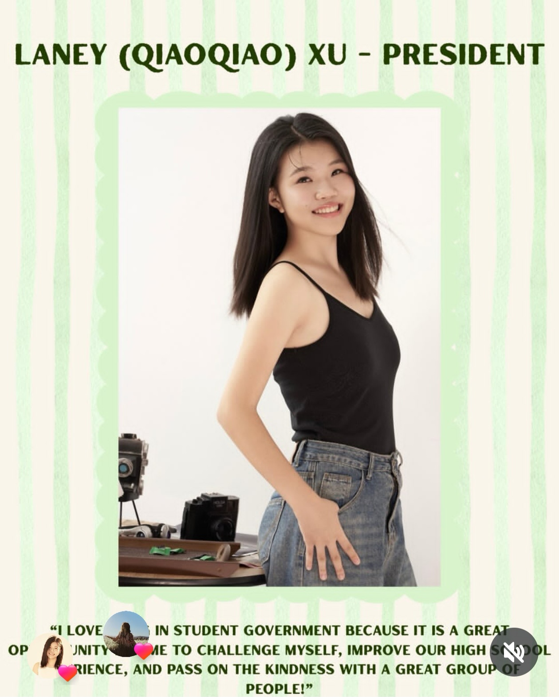
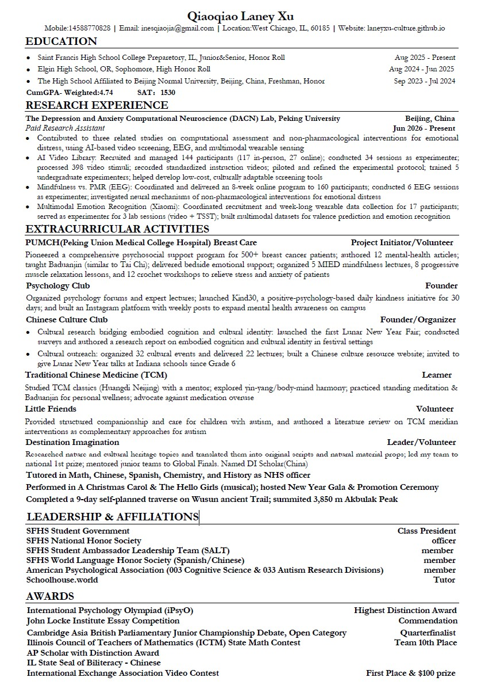

  
  <!-- 照片模块 -->
  

    <!-- 请确保照片已放在 assets/img/ 文件夹下，并修改下面的文件名 -->
    
  

  <!-- 文字介绍模块 -->
  

    <h1 style="margin-top: 0;">About Me</h1>
    

      I'm Laney Xu, a high school student passionate about psychology, cognitive science, Asian studies, and cultural exchange. Outside of school, I am a big history nerd and truly enjoys reading historical records and analyzing historical figures. In addition, I also participate in sports like track and tennis as well as theatre. 
    

  

## My Journey

I've been sharing Chinese culture since elementary school—with students in the U.S., Australia, Spain, Costa Rica and Mexico. 

I was a freshman in **the High School Affiliated to Beijing Normal University** in China, and hosted a cultural exchange orientation for Niles North High School and Niles West High School (IL).

During my exchange year at **Elgin High School** in Oregon, I started the school's first Chinese Culture Club.

Now at **St. Francis High School** in Illinois, I'm an active core member of the Chinese Culture Club. I launched the first Lunar New Year Fair at school and led lecture sessions.

## Why This Website

This site is a space to share:
- Activities and materials from Chinese Culture Club
- Psychology projects from Culture Lab
- Data analysis reports from a computational cognitive science lab
- Stories from my exchange year

---

## Resume

  
  

    <em>Click the image to view full size.</em>
  

